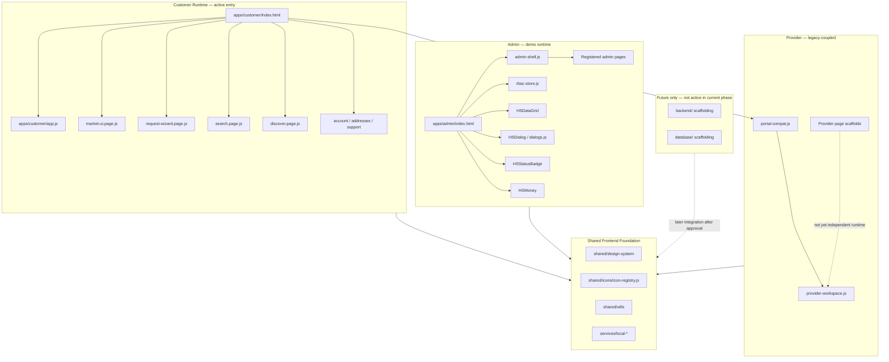

# Current Frontend Dependency Graph

This graph reflects observed entry-point wiring in the supplied archive. It is not a target architecture.

## Verified facts
- Customer is loaded through `apps/customer/index.html` using ordered classic scripts.
- Customer entry currently loads Provider compatibility and workspace scripts.
- `apps/provider/index.html` has no equivalent independent script chain in this archive.
- Admin is loaded through `apps/admin/index.html`; its page modules are registered after shared dependencies and the shell.
- Provider and Admin behavior must not be described as production backend-connected.
- `backend/` and `database/` are preserved future scaffolding, outside the current Frontend implementation scope.

## Change safety
Classic script order, globals, and legacy bridges are runtime contracts. Any reordering or extraction requires tests and browser verification before old wiring is removed.
